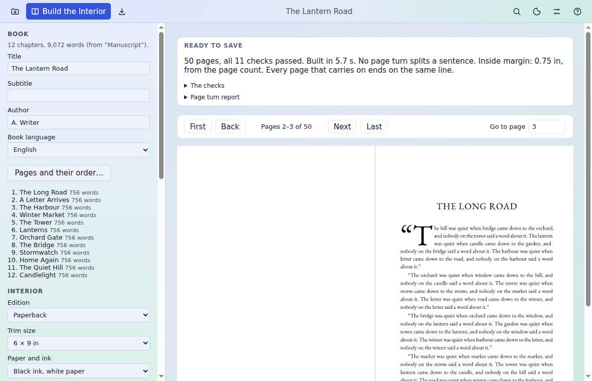
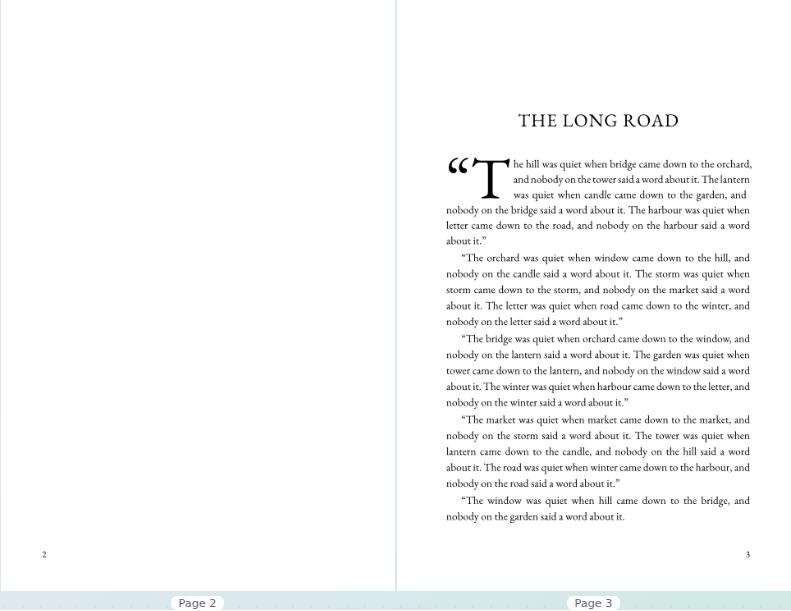
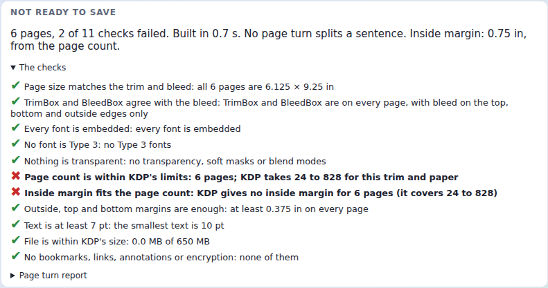
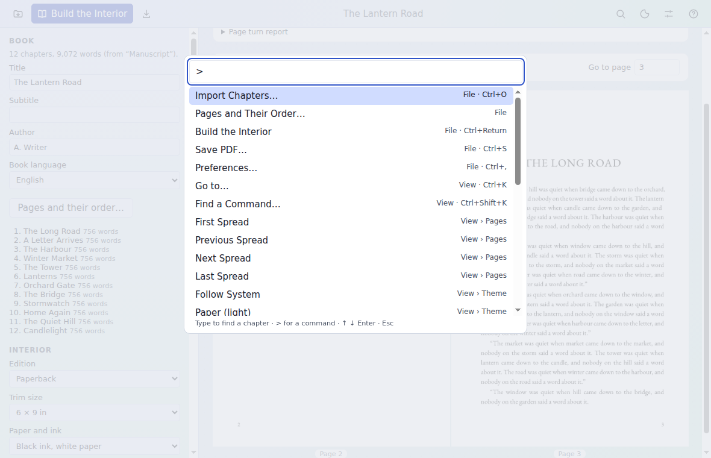
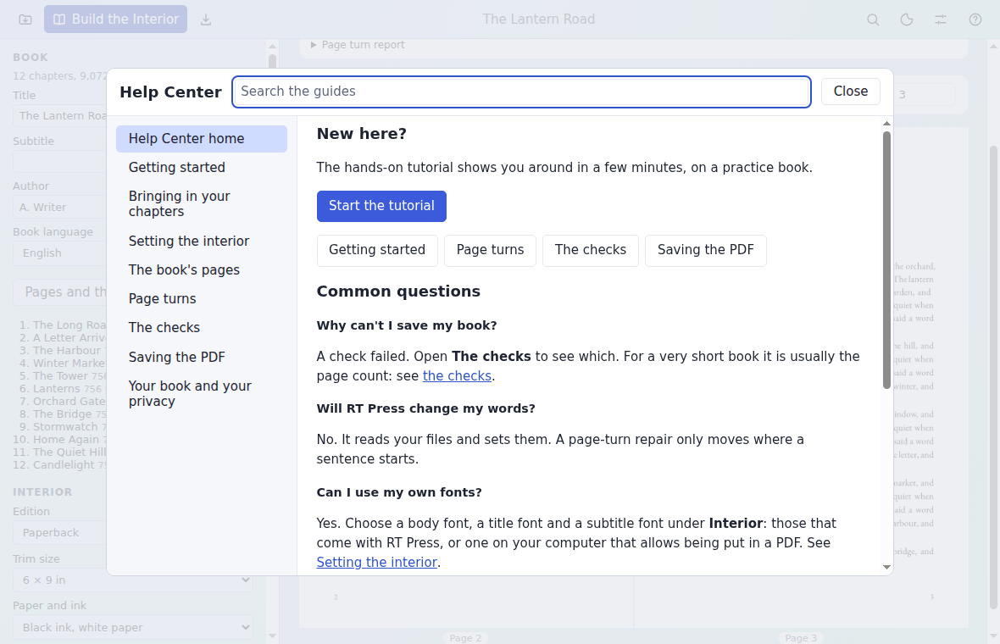
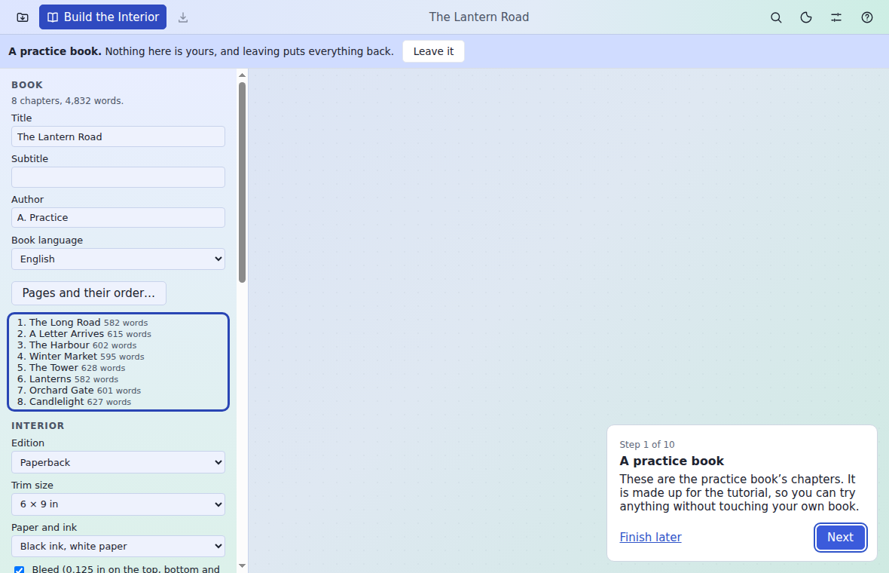
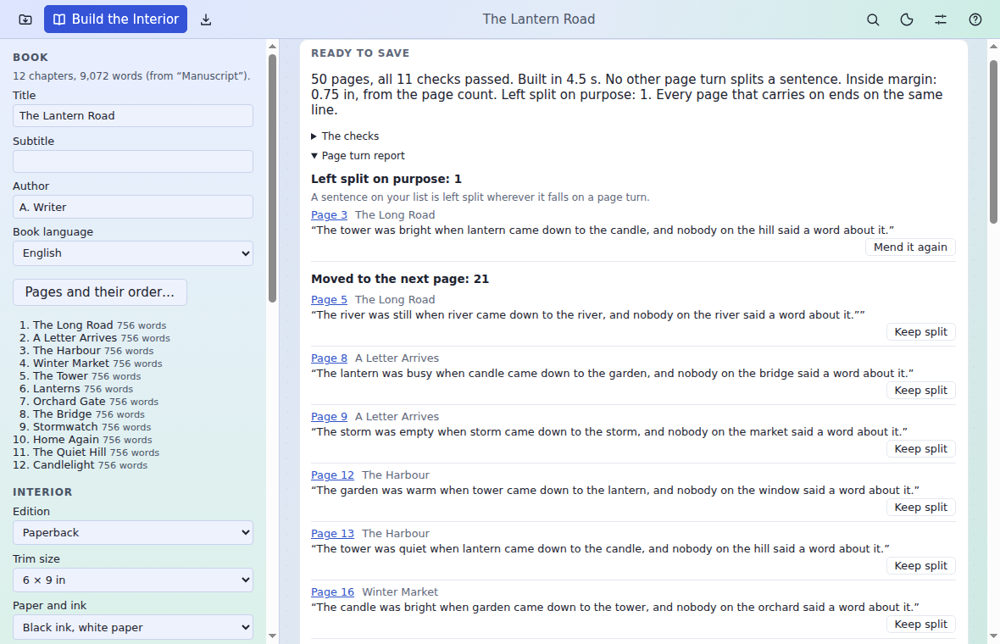
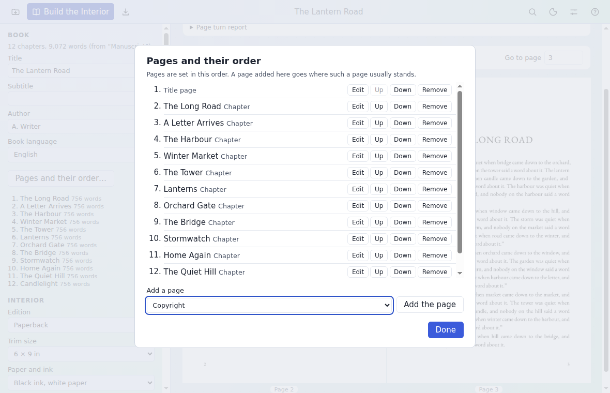

<div align="center">

<a href="https://recontowers.com/projects/"></a>

<br>

[](#download)
[](https://github.com/neogentrics/rt-press/actions/workflows/ci.yml)
[](#what-it-runs-on)
[](#how-your-book-is-kept)
[](LICENSE)

**[Download](#download)** &nbsp;·&nbsp; **[What it does](#what-it-does)** &nbsp;·&nbsp; **[Roadmap](ROADMAP.md)** &nbsp;·&nbsp; **[Step zero results](docs/design/step-zero-results.md)** &nbsp;·&nbsp; **[Project page](https://recontowers.com/projects/)**

</div>

<br>

Designed print interiors and cover wraps, on your own computer. Bring in a finished book and lay it out for print, then check
it against your printer's rules before you upload. Today that means the interior: your chapters, set in a clean book
layout, checked against KDP's rules, and saved only when it passes. Themes, art, page frames and cover wraps come next. For
Windows, Mac and Linux, with no account, no ads and nothing else to install.

RT Press is part of the **Recon Towers** suite, built by its Dev Department. It was inspired by the owner writing his own
books.

> **This is an alpha, on the way to 1.0.** The typesetter was proved on a real book in step zero (see the
> [results](docs/design/step-zero-results.md)), and the app does the whole interior from start to finish for a book of plain
> chapters. Pictures aren't set yet, and KDP's own previewer hasn't seen a file it made. It's for trying, not for printing
> your book yet. What's left before 1.0 is on the [roadmap](ROADMAP.md#where-it-stands).

<table>
<tr>
<td width="50%"><br><b>Build.</b> Bring in your chapters, choose the edition, and see the book as facing pages.</td>
<td width="50%"><br><b>A chapter opens on the right.</b> A title, a drop cap, and a blank page where the book needs one.</td>
</tr>
<tr>
<td><br><b>Checked, not hoped.</b> Every check reads the finished file. A book that breaks a rule can't be saved.</td>
<td><br><b>Only what KDP offers.</b> Pick a trim, and only the papers that come in it are listed.</td>
</tr>
<tr>
<td><br><b>Go to anything.</b> <code>Ctrl+K</code> jumps to a chapter. Start with <code>&gt;</code> to run any command by name.</td>
<td><br><b>Help.</b> Short guides you can search, from the Help menu or <code>F1</code>.</td>
</tr>
<tr>
<td><br><b>A tour on a practice book.</b> Offered the first time, and never touching your own book.</td>
<td><br><b>Every move on record.</b> What was moved, what couldn't be, and a list of the turns you keep for suspense.</td>
</tr>
<tr>
<td><br><b>Your pages, your order.</b> Add a dedication, a part or an also-by page, and put it where you want it.</td>
<td></td>
</tr>
</table>

*The screenshots show a made-up book.*

## Download

| Windows | macOS | Linux |
|---|---|---|
| [`.exe` installer](https://github.com/neogentrics/rt-press/releases/tag/v0.1.0-alpha.0) | [`.dmg` for Apple silicon or Intel](https://github.com/neogentrics/rt-press/releases/tag/v0.1.0-alpha.0) | [`AppImage` or `.deb`](https://github.com/neogentrics/rt-press/releases/tag/v0.1.0-alpha.0) |

[Version 0.1.0-alpha.0](https://github.com/neogentrics/rt-press/releases/tag/v0.1.0-alpha.0) is a pre-release on the
[Releases](https://github.com/neogentrics/rt-press/releases) page. Every build is made and tested on all three systems by
[the Release workflow](https://github.com/neogentrics/rt-press/actions/workflows/release.yml), which opens each built app,
imports a book, sets it, checks it and saves it before anything is published.

The builds aren't code-signed yet, so Windows may show a SmartScreen warning the first time (choose *More info*, then *Run
anyway*), and macOS will ask you to open the app from *System Settings → Privacy & Security*.

**The published 0.1.0-alpha.0 is older than this page.** It was built before the new icon, the menus, Help, the tutorial,
Preferences and the languages, and it doesn't look for updates. Its page-turn repair can also leave a short line
stretched across the page. All of that is changed on the `v1.0` branch, and the next build will have it.

To build it yourself, on Linux:

```bash
npm install
npm run fetch:typst
npm run dist:linux
```

## What it does

| | |
|---|---|
| **Bring in your chapters** | A folder of Word (.docx) files, one for each chapter, in order. Chapter titles are read from the files, curly quotes are set from the text around them, and quotation marks that don't pair are listed so you can check them |
| **Every KDP trim** | All 16 paperback sizes, custom paperback sizes and the 5 hardcover sizes, with only the papers KDP offers for each. KDP publishes no page limits for a custom size, so those are Press's own, and it says so |
| **Your fonts, or ten that come with it** | Body, title and subtitle fonts from those that ship with Press or those on your computer that allow being put in a PDF. Open stand-ins for Book Antiqua, Felix Titling and Segoe UI Symbol. A missing character stops the build: nothing is borrowed from another font |
| **Book themes** | Five designs for the printed pages, from Garamond with a drop cap to sans titles with the chapter in the running head. Change anything and save it as your own. A change shows in the pages at once |
| **Set like a book** | Mirrored margins with the inside one taken from the page count, or your own; chapter labels, subtitles, drop caps, scene breaks, running heads and page numbers; the book's language for hyphenation and quotation marks; and house rules you can switch: titles on right-hand pages, a blank even last page, no line starting with a dash |
| **Front and back matter** | Title page, copyright, dedication, acknowledgements, contents, prologue, parts, epilogue, appendices, a preview, also by, stay connected and more, added where they usually stand, edited as plain text, and moved where you like |
| **No sentence split across a page turn** | Where a page ends in the middle of a sentence, the sentence starts on the next page instead, in rounds, and the book is set again each time. By default no page is added: a sentence is only moved where its chapter has room. Or let pages be added, as far as a pinned count allows, or leave the pages as set. What's left behind on a line ends short, like the end of a paragraph, unless it's nearly full already. The repair never changes your words |
| **A report, and your keep list** | What was moved, what couldn't be and why, each with its page. Put a sentence on your list to leave it split for suspense |
| **Even page bottoms** | Pages whose text carries on are brought to the same last line by sharing a little space between lines and paragraphs, without moving a word to another page. Pages that can't be done gently are left, and counted |
| **Bleed done the KDP way** | 0.125 in on the top, bottom and outside edges, none at the spine, with the page boxes written |
| **Pin the page count** | Keep a published page count, so an existing cover still fits |
| **Check before you save** | Eleven checks on the finished file: page size, page boxes, fonts embedded and none Type 3, nothing transparent, page count, inside and outer margins, text size, file size, and no bookmarks, links or encryption |
| **See it first** | The whole book as facing pages, in about a second |
| **Fast** | A 128-page book is set, finished and checked in about a second. Repairing its page turns takes from about ten seconds to two minutes, by the choice made |
| **Your choices are kept** | The book, its details and your settings are saved, and are there when you open the app again |
| **Menus, and every command by name** | File, Edit, View and Help, kept short, with an icon toolbar. `Ctrl+K` jumps to a chapter, and `>` there runs any command |
| **Help and a tutorial** | A Help Center of searchable guides, and a hands-on tour on a practice book that can be put aside, picked up again, or refused |
| **Your language** | The app's own words in English, Spanish, French or German, following your system or as you choose in Preferences. The guides are in English. The other three haven't been checked by a native speaker yet |
| **Updates itself** | On Windows and the Linux AppImage it downloads a new version and offers *Restart to update*; on a Mac and the `.deb` it tells you where to get it. You can turn the check off |
| **The suite's themes** | Ten themes from the theme button, or *Auto* to follow your system, each with a *Solid*, *Metallic* or *Glass* look, and colour-safe colours. The page preview stays plain white paper |
| **For everyone** | Every button is named, the text meets WCAG AA contrast in every theme with every look, and everything can be reached from the keyboard, all checked by the tests |
| **Private by default** | Your book is kept in an encrypted project on your own computer |
| **Works offline** | No account, no server, and your writing never leaves your computer. The one thing it asks the internet is whether there's a newer version, and you can turn that off |

**Coming next, for 1.0:** books from a single Word, Markdown or EPUB file and from RT Story Tracker, and every KDP rule shown on the page it's on. See the [roadmap](ROADMAP.md).

## What it won't do

- Edit a book that lives in RT Story Tracker. Its words stay there, and Press jumps you to the chapter to fix a typo.
- Paint or draw. Cover art and sketches are made elsewhere and placed here.
- Upload to a store. It writes the files and checks them, and you upload them yourself.
- Need AI. That's an add-on, off until you turn it on, with your choice of service, including a model on your own computer.

## How your book is kept

Your book and your settings are kept in an encrypted project in the app's own folder, with its own random key. With no
password set, any copy of this app can open it, so that's privacy from a casual look, not secrecy. Your original Word files
are only read, never changed. The PDF is written only when you choose Save, and only if every check passed.

## What it runs on

The same base as RT Story Tracker: Electron, with an encrypted SQLite database inside the app, on Windows 10 or later,
macOS 13 or later and Linux. The pages are set by [Typst](https://github.com/typst/typst) (Apache-2.0), an open typesetter
that ships inside the app, so there's nothing else to install. The fonts ship inside it too, under the SIL Open Font License
and, for TeX Gyre Pagella, the GUST Font License; see the [notices](THIRD_PARTY_NOTICES.md). See [typesetting](docs/design/typesetting.md).

## Running it from the source

You need Node.js 22 or newer.

```bash
npm install
```

```bash
npm run fetch:typst:current
```

```bash
npm start
```

```bash
npm test
```

```bash
npm run test:e2e
```

`npm run fetch:typst:current` downloads the Typst program for this computer and checks it against the hash pinned in
`vendor/typst.lock.json`. The fonts are gathered from `node_modules` and `fonts/` the first time they're needed, or with
`npm run fonts`.

The icons are made from [docs/brand/icon.svg](docs/brand/icon.svg) by `npm run icons`, the screenshots on this page by
`npm run screenshots` (with a made-up book; under `xvfb-run -a` on a machine with no screen), and the banner by
`npm run banner`. The suite's window themes are taken in with `npm run theme:sync -- --tag <version>`, which needs access to
the repo they live in. What it copies is committed in `src/theme` with a `theme.lock`, so building never needs that access.

## How the code is laid out

- `src/main`: everything that runs outside the window, including the menus, app settings, updates and the suite's installed list.
- `src/main/press`: the book, the settings and the build, from chapters to a checked file. It holds nothing of Electron's, so it can be tried on its own.
- `src/main/typeset`: the Typst source for a book and a theme, and the fonts: the ones that ship, the computer's, and the check that none lacks a character.
- `fonts`: the font files kept in this repository, with their licences.
- `src/main/pdf`: reading and writing PDFs, and the finishing step that makes Typst's file ready for a printer.
- `src/main/checks`: the checks, which read the finished PDF.
- `src/main/steer`: finding the pages that split a sentence, and the steers that move them. The build uses it.
- `src/main/import`: Word chapters in.
- `src/main/storage`: the only code that touches the encrypted project.
- `src/main/theme`: reads the suite's window themes and refuses a copy that doesn't match its `theme.lock`.
- `src/theme`: the suite's shared themes and looks, copied in at a tag. Not edited here.
- `src/renderer`: the window and the frame round it, bundled into `dist/renderer` by `npm run build:renderer`.
- `src/locales`: the translations, made from the tables in `src/locales/source` by `npm run locales`.
- `help`: the Help Center's guides, in Markdown.
- `src/shared`: what both sides need, such as the book, the theme and KDP's numbers (`print-rules.js`).

The plan behind it all is in the [roadmap](ROADMAP.md) and the [decisions](docs/decisions.md), with designs for
[typesetting](docs/design/typesetting.md), the [print rules](docs/design/print-rules.md), the [other platforms print rules](docs/design/print-rules-other-platforms.md) and
[working with the suite](docs/design/working-with-the-suite.md), and what step zero found in the
[results](docs/design/step-zero-results.md).

## Licence

Proprietary. See [LICENSE](LICENSE) and [THIRD_PARTY_NOTICES.md](THIRD_PARTY_NOTICES.md).
