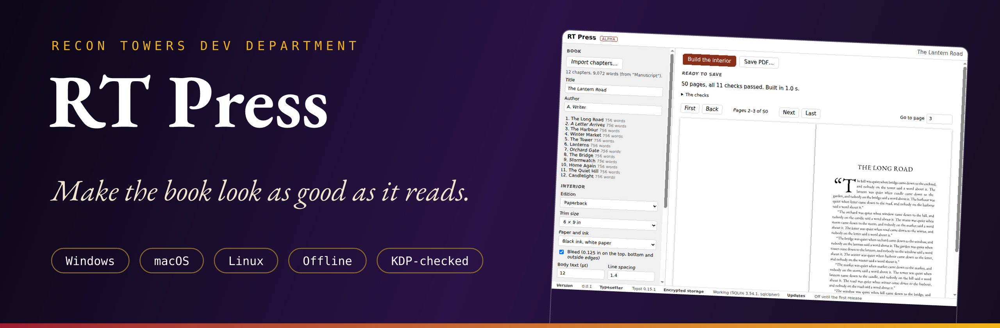
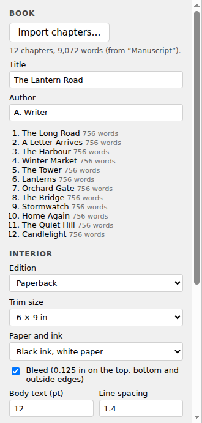

<div align="center">

<a href="https://recontowers.com/projects/"></a>

<br>

[](#download)
[](https://github.com/neogentrics/rt-press/actions/workflows/ci.yml)
[](#what-it-runs-on)
[](#how-your-book-is-kept)
[](LICENSE)

**[Download](#download)** &nbsp;·&nbsp; **[What it does](#what-it-does)** &nbsp;·&nbsp; **[Roadmap](ROADMAP.md)** &nbsp;·&nbsp; **[Step zero results](docs/design/step-zero-results.md)** &nbsp;·&nbsp; **[Project page](https://recontowers.com/projects/)**

</div>

<br>

Designed print interiors and cover wraps, on your own computer. Bring in a finished book and lay it out for print, then check
it against your printer's rules before you upload. Today that means the interior: your chapters, set in a clean book
layout, checked against KDP's rules, and saved only when it passes. Themes, art, page frames and cover wraps come next. For
Windows, Mac and Linux, with no account, no ads and nothing else to install.

RT Press is part of the **Recon Towers** suite, built by its Dev Department. It was inspired by the owner writing his own
books.

> **This is an alpha.** The typesetter was proved on a real book in step zero (see the
> [results](docs/design/step-zero-results.md)), and this first app does the whole interior from start to finish for a book of
> plain chapters. Page turns are not yet repaired, in-story documents and pictures are not there, and the type is EB Garamond
> only. It's for trying, not for printing your book yet.

<table>
<tr>
<td width="50%"><br><b>Build.</b> Bring in your chapters, choose the edition, and see the book as facing pages.</td>
<td width="50%"><br><b>A chapter opens on the right.</b> A title, a drop cap, and a blank page where the book needs one.</td>
</tr>
<tr>
<td><br><b>Checked, not hoped.</b> Every check reads the finished file. A book that breaks a rule can't be saved.</td>
<td><br><b>Only what KDP offers.</b> Pick a trim, and only the papers that come in it are listed.</td>
</tr>
</table>

*The screenshots show a made-up book.*

## Download

There is no release yet. The alpha is built from the source, for Linux today:

```bash
npm install
npm run fetch:typst:current
npm run dist:linux
```

That makes an `AppImage` and a `.deb` in `release/`. Windows and Mac builds are set up the same way and haven't been run yet.
When there is a release, it will be on the [Releases](https://github.com/neogentrics/rt-press/releases/latest) page, with an
`.exe` installer for Windows, a `.dmg` for Apple silicon or Intel, and an `AppImage` or `.deb` for Linux.

## What it does

| | |
|---|---|
| **Bring in your chapters** | A folder of Word (.docx) files, one for each chapter, in order. Chapter titles are read from the files, curly quotes are set from the text around them, and quotation marks that don't pair are listed so you can check them |
| **Every KDP trim** | Paperback and hardcover, with only the papers and page limits KDP offers for each size |
| **Set like a book** | Mirrored margins, every chapter starting on a right-hand page, a drop cap, scene breaks, page numbers outside or centred, an optional title page and contents page, and a blank last page |
| **Bleed done the KDP way** | 0.125 in on the top, bottom and outside edges, none at the spine, with the page boxes written |
| **Pin the page count** | Keep a published page count, so an existing cover still fits |
| **Check before you save** | Eleven checks on the finished file: page size, page boxes, fonts embedded and none Type 3, nothing transparent, page count, inside and outer margins, text size, file size, and no bookmarks, links or encryption |
| **See it first** | The whole book as facing pages, in about a second |
| **Fast** | A 128-page book is set, finished and checked in about a second |
| **Your choices are kept** | The book, its details and your settings are saved, and are there when you open the app again |
| **Private by default** | Your book is kept in an encrypted project on your own computer |
| **Works offline** | No account, no server, and your writing never leaves your computer |

**Coming next:** repairing page turns so no sentence is split across them, themes, art and page frames, cover wraps, and
chapters sent from RT Story Tracker. See the [roadmap](ROADMAP.md).

## What it won't do

- Edit a book that lives in RT Story Tracker. Its words stay there, and Press jumps you to the chapter to fix a typo.
- Paint or draw. Cover art and sketches are made elsewhere and placed here.
- Upload to a store. It writes the files and checks them, and you upload them yourself.
- Need AI. That's an add-on, off until you turn it on, with your choice of service, including a model on your own computer.

## How your book is kept

Your book and your settings are kept in an encrypted project in the app's own folder, with its own random key. With no
password set, any copy of this app can open it, so that's privacy from a casual look, not secrecy. Your original Word files
are only read, never changed. The PDF is written only when you choose Save, and only if every check passed.

## What it runs on

The same base as RT Story Tracker: Electron, with an encrypted SQLite database inside the app, on Windows 10 or later,
macOS 13 or later and Linux. The pages are set by [Typst](https://github.com/typst/typst) (Apache-2.0), an open typesetter
that ships inside the app, so there's nothing else to install. The type is EB Garamond (SIL Open Font License 1.1), also
shipped inside the app. See [typesetting](docs/design/typesetting.md).

## Running it from the source

You need Node.js 22 or newer.

```bash
npm install
```

```bash
npm run fetch:typst:current
```

```bash
npm start
```

```bash
npm test
```

```bash
npm run test:e2e
```

`npm run fetch:typst:current` downloads the Typst program for this computer and checks it against the hash pinned in
`vendor/typst.lock.json`. The fonts are unpacked from `@fontsource` the first time they're needed, or with
`npm run fonts:stand-in`.

## How the code is laid out

- `src/main`: everything that runs outside the window.
- `src/main/press`: the book, the settings and the build, from chapters to a checked file. It holds nothing of Electron's, so it can be tried on its own.
- `src/main/typeset`: the Typst source for a book and a theme, and the fonts.
- `src/main/pdf`: reading and writing PDFs, and the finishing step that makes Typst's file ready for a printer.
- `src/main/checks`: the checks, which read the finished PDF.
- `src/main/steer`: finding the pages that split a sentence, and moving them, as a tested experiment not yet in the window.
- `src/main/import`: Word chapters in.
- `src/main/storage`: the only code that touches the encrypted project.
- `src/renderer`: the window, bundled into `dist/renderer` by `npm run build:renderer`.
- `src/shared`: what both sides need, such as the book, the theme and KDP's numbers (`print-rules.js`).

The plan behind it all is in the [roadmap](ROADMAP.md) and the [decisions](docs/decisions.md), with designs for
[typesetting](docs/design/typesetting.md), the [print rules](docs/design/print-rules.md) and
[working with the suite](docs/design/working-with-the-suite.md), and what step zero found in the
[results](docs/design/step-zero-results.md).

## Licence

Proprietary. See [LICENSE](LICENSE).
